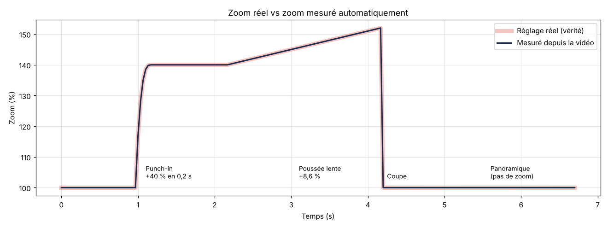

# Mesurer les zooms et les mouvements d'une vidéo

- `mesure-zoom.py VIDEO.mp4` : détecte les coupes, les zooms (en %, durée, vitesse, courbe d'accélération, point visé) et les panoramiques. Il écrit le résultat dans `pattern.json`.
- `video-test-zooms.py` : fabrique une vidéo de test avec des zooms connus, pour vérifier la précision.
- Résultat du test (vidéo compressée en H.264) :

| Réglage réel | Mesuré |
|---|---|
| Zoom « boum » de +40 % en 6 images, qui freine à la fin | +40,0 % en 6 images, freinage détecté |
| Le point visé : le mot surligné | Tombé exactement sur le mot (même pixel) |
| Poussée lente de 140 % à 152 % en 2 s | +8,6 %, de 140,0 % à 152,0 % en 2,0 s |
| Coupe à 4,2 s | Coupe à 4,2 s |
| Panoramique de 400 px | 398 px |

**Limites** : la mesure est très fiable sur des écrans, des articles ou des images fixes. Elle l'est moins quand le sujet bouge lui-même (une personne qui marche), en cas de flou de mouvement ou de vidéo très compressée. Dans ces cas, on mesure le mouvement du fond.
