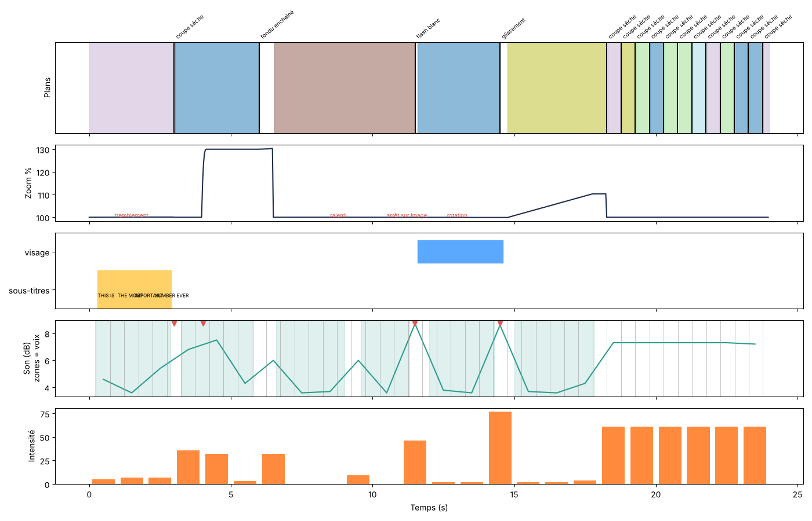

# Pattern de montage : full.mp4

Durée 24.0 s · 17 plans · 42.5 plans/min · plan moyen 1.34 s (médiane 0.47 s)

## Transitions
| Temps | Type | Durée |
|---|---|---|
| 3.0 s | coupe sèche | 0 images |
| 6.0 s | fondu enchaîné | 16 images |
| 11.5 s | flash blanc | 3 images |
| 14.5 s | glissement vers la gauche | 8 images |
| 18.27 s | coupe sèche | 0 images |
| 18.77 s | coupe sèche | 0 images |
| 19.27 s | coupe sèche | 0 images |
| 19.77 s | coupe sèche | 0 images |
| 20.27 s | coupe sèche | 0 images |
| 20.77 s | coupe sèche | 0 images |
| 21.27 s | coupe sèche | 0 images |
| 21.77 s | coupe sèche | 0 images |
| 22.27 s | coupe sèche | 0 images |
| 22.77 s | coupe sèche | 0 images |
| 23.27 s | coupe sèche | 0 images |
| 23.77 s | coupe sèche | 0 images |

## Mouvements
| Temps | Type | Détails |
|---|---|---|
| 0.9 s | tremblement | dur_s : 0.8, amplitude_px : 7.0, frequence_hz : 10.0 |
| 4.0 s | punch-in | dur_frames : 4, dur_s : 0.13, zoom_pct : 29.8, vitesse_max_pct_par_image : 14.6, courbe : freine à la fin (ease-out), point_vise_pct : [62, 33] |
| 8.5 s | ralenti | vitesse_avant_px_img : 12.0, vitesse_apres_px_img : 6.0, facteur : 0.5 |
| 10.5 s | arrêt sur image | dur_s : 1.0 |
| 12.63 s | rotation | dur_s : 1.0, degres : -7.9 |
| 14.8 s | poussée lente | dur_frames : 91, dur_s : 3.03, zoom_pct : 10.4, vitesse_max_pct_par_image : 0.1, courbe : constante, point_vise_pct : [50, 50] |

## Plans (couleurs)
| Début | Durée | Luminosité | Contraste | Saturation | Teinte | Température |
|---|---|---|---|---|---|---|
| 0.0 s | 3.0 s | 29 % | 11 % | 29 % | vert | neutre |
| 3.03 s | 2.97 s | 34 % | 14 % | 77 % | orange | chaude |
| 6.53 s | 4.97 s | 10 % | 7 % | 13 % | neutre | neutre |
| 11.6 s | 2.9 s | 60 % | 25 % | 24 % | orange | chaude |
| 14.77 s | 3.5 s | 28 % | 9 % | 72 % | bleu | froide |
| 18.3 s | 0.47 s | 38 % | 15 % | 22 % | vert | neutre |
| 18.8 s | 0.47 s | 29 % | 9 % | 51 % | bleu | froide |
| 19.3 s | 0.47 s | 35 % | 14 % | 68 % | cyan | froide |
| 19.8 s | 0.47 s | 28 % | 9 % | 23 % | rouge | chaude |
| 20.3 s | 0.47 s | 32 % | 9 % | 28 % | cyan | froide |
| 20.8 s | 0.47 s | 47 % | 15 % | 32 % | cyan | froide |
| 21.3 s | 0.47 s | 44 % | 15 % | 57 % | jaune | chaude |
| 21.8 s | 0.47 s | 24 % | 11 % | 59 % | vert | neutre |
| 22.3 s | 0.47 s | 29 % | 10 % | 53 % | cyan | froide |
| 22.8 s | 0.47 s | 43 % | 14 % | 31 % | orange | chaude |
| 23.3 s | 0.47 s | 22 % | 8 % | 56 % | orange | chaude |
| 23.8 s | 0.2 s | 33 % | 11 % | 47 % | vert | neutre |

## Sous-titres
4 sous-titres · 1.8 mots en moyenne · 0.65 s chacun · centre à 82 % de la hauteur · texte haut de 6.9 % · surlignage : jaune

- 0.3 s : « THIS IS » (mot surligné : IS, jaune)
- 1.0 s : « THE MOST » (mot surligné : MOST, jaune)
- 1.6 s : « IMPORTANT » (mot surligné : IMPORTANT, jaune)
- 2.3 s : « NUMBER EVER » (mot surligné : NUMBER, jaune)

## Visages
Présents : [[11.6, 14.6]] · taille moyenne 10.5 % de l'écran · position moyenne [42, 55] (en % de l'écran)

## Son
- Volume intégré : -20.2 LUFS
- Tempo : 120 BPM · coupes sur le temps : 12 coupes sèches sur 13 (au hasard, on en attendrait ≈ 27 %)
- Voix : 6 passages · pauses [0.37, 0.79, 0.58, 0.69, 0.7] s (moyenne 0.63 s)
- Débit estimé : 5.1 syllabes/s ≈ 205 mots/min (estimation sans transcription)
- Baisse de la musique sous la voix : 10.0 dB (estimation sans séparation des pistes)
- Effets sonores : 3.0 s souffle (whoosh) → calé sur coupe sèche, 4.02 s impact grave (boum) → calé sur punch-in, 11.49 s souffle (whoosh) → calé sur flash blanc, 14.49 s souffle (whoosh) → calé sur glissement

## Intensité (0-100, par seconde)
5 7 7 36 32 3 32 0 0 9 0 46 2 2 77 2 2 4 61 61 61 61 61 61

